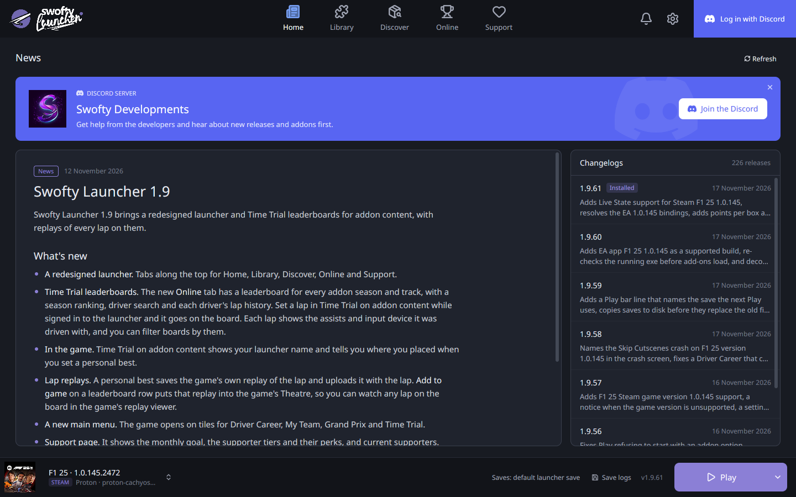

# Swofty Launcher for F1 25

A launcher and mod loader for F1 25 on Windows and Linux. Addons change the game's data and engine, mods and community tracks drop onto the Mods page, and profiles keep separate setups.



## Features

- **Addons:** Anything with a `swofty.json`, installed on the Addons page. Data addons change the game database, text, `.erp` archives, menus and files through operations, applied at build time or while the game boots through the Asset API. Code addons use the Advanced Mod Mixin System to edit the F1 25 engine directly, from new menus and settings to bigger grids, or add pages to the launcher.
- **Mods:** Content with no code, as the Simplified Suite loads it: `.serps` packages, `.erp` archives and other game files in a zip, 7z, RAR or folder, and community tracks such as Sepang and Okayama. Drop them on the launcher's Mods page, which comes from Team Simplified's Simplified for Swofty addon.
- **DB Editor:** Change drivers, teams, line-ups, tracks, the calendar, weather, points and any other value in the game database from the launcher. Changes are saved as packages: data addons you turn on per profile, stack and share as zips. EGO GameDatabases Editor exports of value changes import as packages.
- **Profiles:** Keep separate setups like *Vanilla*, *26 car grid* or *Classic tracks*. The game folder goes back to vanilla when a session ends.
- **In-game addon settings:** Change addon settings from the game's main menu, in **ADDON SETTINGS** under Career.
- **Swofty UI:** View and edit the game's menu layouts (`.idf` scenes) with real textures, then ship the edits in an addon. It comes with every release as `bin/swofty-ui`. See [Swofty UI](https://f1.swofty.net/reference/ui/swofty-ui).

## Install

Follow the [installation guide](https://f1.swofty.net/guide/installation).

## Supported platforms

- Windows 10 and 11 with Steam.
- Linux with Steam and Proton, including Steam Deck, NixOS and Flatpak Steam.
- F1 25 on Steam, including the F1 2026 season content.

## Contributing

```bash
nix develop                     # development tools on NixOS
cargo fmt --all --check
cargo clippy --all-targets -- -D warnings
cargo test                      # set F1_25_DIR to test with your game files
cargo run -p swofty-launcher
native/build.sh
native/test/run_wine_test.sh
pnpm install
pnpm docs:dev
```

See the [development guide](https://f1.swofty.net/reference/development) for build details.

## Licence

Licensed under the [PolyForm Noncommercial License 1.0.0](LICENSE). Copyright Swofty Pty Ltd (ACN 665 787 244).

The plugin SDK in `packages/sdk` and the addon template in `templates/addon` use the MIT licence. The docs theme adapts MIT-licensed CSS from the Geode docs, Swofty UI's texture decoder is ported from MIT-licensed bcdec_rs and bcdec; see [THIRD_PARTY.md](THIRD_PARTY.md).

## Credits

- [xanpavle](https://github.com/xanpavle) for [F1 25 RE-Optimization](https://github.com/xanpavle/F1-25-RE-Optimization), the renderer tuning, engine overrides and GPU-aware upscaler choice behind the `xanpavle.re-optimization` addon in the Addon Browser.
